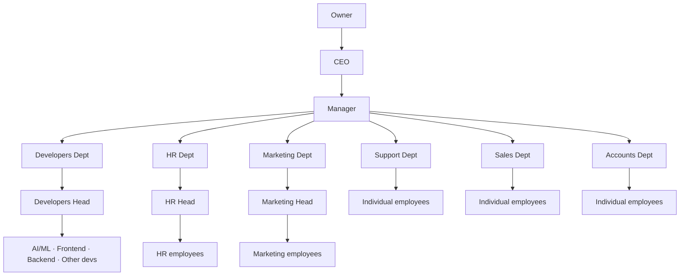

# Document 1 — Business Requirement Document (BRD)

## 1. Business objective
Give management a single system to **assign work, see its real progress, measure actual effort, enforce deadlines with accountability, and surface blockers early** — across a hierarchical organization (Owner → CEO → Manager → Department Heads → Employees).

## 2. Problem statement
Work is assigned informally (chat/verbal). Consequently: no single record of who owns what; deadlines move silently; late work isn't explained; actual effort is unknown vs estimates; blockers are discovered after the deadline; management can't see workload before assigning more.

## 3. Out of scope (explicit)
Payroll, attendance, performance appraisal scoring, screenshot/keystroke monitoring, client-facing portal, mobile native apps (responsive web only), multi-company tenancy.

## 4. Target users
| Persona | Primary need |
|---|---|
| Owner | Org-wide truth: what's late, why, who's overloaded; can intervene anywhere |
| CEO | Same breadth; manages departments' delivery |
| Manager | Supervise a defined set of employees/departments; review completion & delays |
| Department Head (Developers, HR, Marketing) | Run their department's queue; assign & review within department |
| Employee (incl. Support/Sales/Accounts with no head) | Know what to do first, track time, report blockers, explain delays quickly |
| System Admin (role, may be the Owner) | Configure org, roles, rules |

## 5. Organizational model
Initial structure is **seed data, not code**:

- Support/Sales/Accounts employees report **directly to a Manager** (no head). Adding a "Sales Head" later = create the role assignment, set `departments.head_employee_id`, and re-point `reporting_relationships` — no schema/code change.
- Reporting relationships are **effective-dated** (history kept), so a manager change doesn't rewrite the past.

## 6. Core business workflows
1. **Assign** → task saved → assignee + resolved hierarchy notified (in-app + email, de-duplicated).
2. **Acknowledge** → **Start** (timer) → **Progress updates** → **Submit for review** → **Approve** (or **Reopen**).
3. **Deadline change** (authorized roles only) → history row with reason → notify.
4. **Reminders** → T-24h, T-2h, due → overdue flag, +1d, +3d escalate, +7d escalate.
5. **Overdue** → employee must submit a delay explanation → manager accepts / asks clarification / rejects / approves new deadline / escalates. Explanation ≠ completion.
6. **Blocker** → raised by employee → managers notified → resolved; blocked time excluded from active time.
7. **Time tracking** → start/pause/resume/stop sessions, server timestamps, one active timer per employee.
8. **Reporting** → 12 reports, filter + export (CSV/XLSX/PDF).

## 7. Expected outcomes / success measures
- 100% of tasks have owner, deadline, estimate, history.
- Zero silent deadline changes (every change has actor + reason).
- ≥ 95% of overdue tasks have a delay explanation within 1 working day (behavioural KPI).
- Management can answer "who is overloaded / what is late / why" in < 1 minute from dashboard.
- Zero duplicate or stale reminder emails (verified by tests and `reminder_log`).

## 8. Assumptions & constraints
Single company, ≤ 200 users (Q16), English UI, UTC storage with per-user timezone, SMTP email, self-hosted Linux. See open questions in [00-README](00-README-and-open-questions.md).

## 9. Key risks (business)
Employee perception of surveillance → keep time tracking self-reported, transparent (employee sees what management sees); "productivity scores" omitted deliberately (Q18, Q20).
