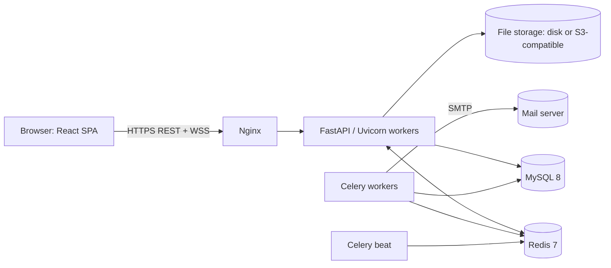
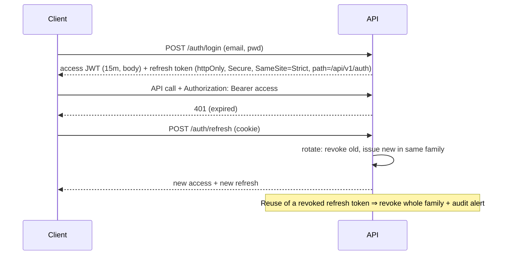

# Document 4 — System Architecture

Style: **modular monolith** (one deployable API, separate worker process, shared codebase). Modules communicate via service interfaces and domain events, never by reaching into each other's tables.

## 1. Context



## 2. Backend architecture (FastAPI)

```
backend/
  app/
    main.py                # app factory, middleware, routers
    core/                  # config (pydantic-settings), security, logging, time, errors, db session
    modules/
      auth/        users/   org/ (departments, employees, hierarchy)   rbac/
      projects/    tasks/   (state machine, assignments)
      deadlines/   delays/  timetracking/   blockers/   comments/
      notifications/ (rules, resolver, channels, ws)  reminders/
      reports/     audit/   files/   settings/
        each: router.py  schemas.py (Pydantic)  service.py  repo.py  models.py  events.py  policies.py
    jobs/                  # Celery tasks (thin wrappers around services)
  alembic/  tests/
```
Rules:
- **Router** = HTTP only (validation, auth dependency). **Service** = business rules + transaction boundary. **Repo** = SQLAlchemy 2.0 queries. **Policy** = authorization (`can(user, action, obj)`), reused by REST, WebSocket, jobs, exports.
- One DB transaction per use case; domain events are written to `outbox_events` **in the same transaction** (transactional outbox) → a relay job fans them to notifications/audit. No lost notifications if Redis/SMTP is down.
- Pydantic v2 schemas; error envelope `{code, message, details, request_id}`; stable error codes (`INVALID_TRANSITION`, `OUT_OF_SCOPE`, `TIMER_ALREADY_ACTIVE`, …).
- OpenAPI → TypeScript client (`openapi-typescript` + typed fetch) so FE/BE can't drift.
- SQLAlchemy 2.0 sync or async? **Recommend sync SQLAlchemy + PyMySQL/mysqlclient behind Uvicorn threadpool** for MVP: simpler, fewer pitfalls with Celery sharing models; async adds little at 200 users. WebSockets stay async. Revisit only if profiling demands.

### State machine & concurrency
- Transitions in one `TaskStateMachine` class (table-driven from SRS §3). Every mutating task call takes `SELECT … FOR UPDATE` on the task row (or optimistic `version` column → 409 on conflict).
- Timers: `SELECT … FOR UPDATE` on `employees` row for the actor, then check no open session; DB generated-column unique index is the safety net (see doc 5).

## 3. Frontend architecture
React 19 + TS + Vite · React Router (data routers, route-level code splitting) · TanStack Query (server state; no Redux) · Tailwind + shadcn/ui + Lucide · Recharts · React Hook Form + Zod (forms; schemas mirror API) · small Zustand store only for UI state (sidebar, timer widget).

```
frontend/src/
  app/ (router, providers, layouts)   components/ui (shadcn)   components/shared
  features/ auth tasks time delays blockers notifications org reports dashboard settings
     each: api/ hooks/ components/ pages/ schemas.ts
  lib/ (http client w/ refresh interceptor, ws client, tz utils, permissions)
```
- **Permission-aware UI**: `/auth/me` returns effective permissions+scopes; `<Can permission="task.deadline.edit" target={task}>` hides controls. *UI hiding is convenience only* — backend is authoritative.
- Timer widget in the app shell reads `/time/active` (server truth), ticks locally for display, re-syncs on focus/visibility/reconnect.
- WebSocket client: reconnect w/ backoff, on event → invalidate relevant TanStack queries; fallback poll 30 s.
- Dates: store/transport UTC, format with `Intl` + user tz.

## 4. Authentication flow


- Access token kept **in memory only** (not localStorage) → XSS can't exfiltrate a long-lived credential. Refresh cookie is httpOnly + CSRF-safe via SameSite=Strict and a custom header check on `/auth/refresh`.
- Claims: `sub`, `jti`, `exp`, `ver` (user token_version → instant revocation on role/password change). Permissions are **not** embedded; fetched from DB/cache per request so role edits apply immediately.
- Hashing: argon2id. Lockout + rate limit via Redis (`slowapi`-style).
- Alternative considered: server-side session cookies (simpler, easy revocation). Chosen JWT because you listed it and SPA + WebSocket fits; the above mitigations make it equivalent in revocation power.

## 5. Notification architecture

```mermaid
flowchart LR
  S[Service use case] -->|same TX| O[(outbox_events)]
  O --> RL[Relay job (every 5s / on commit signal)]
  RL --> RR[Recipient Resolver]
  RR -->|rules + hierarchy + prefs + dedupe| N[(notifications)]
  N --> WS[Redis pub/sub → WebSocket gateway → browser]
  N --> EQ[Email queue]
  EQ --> EW[Email worker: render → SMTP → email_logs, retry]
```
**Recipient resolution (no hardcoding).** `notification_rules(event_type, recipient_selector, channel, mandatory, enabled, condition_json)`. Selectors are *relations*, evaluated against the event's task/actor:
`ASSIGNEE`, `ASSIGNER`, `DIRECT_MANAGER`, `MANAGER_CHAIN(n)`, `DEPARTMENT_HEAD`, `ROLE(code)` (e.g. all CEOs), `WATCHERS`, `MENTIONED`, `BLOCKER_OWNER`, `ESCALATION(level)`.
Algorithm: collect candidates → expand selectors via hierarchy as-of event time → drop inactive users, drop the actor (unless confirmation rule) → **dedupe by user, merging reasons** (one notification "because you are: Manager, Dept Head") → apply user prefs (mandatory rules ignore mute) → persist → fan out. Example "Owner assigns to ABC": ASSIGNEE, DIRECT_MANAGER, DEPARTMENT_HEAD, ROLE(CEO) → ABC, Manager, Developers Head, CEO; Owner gets confirmation only if enabled.
Email: Jinja templates, plain+HTML, `email_logs` per attempt (status, provider response, attempts), retries 1m/5m/30m/2h/12h then `failed` visible in admin; bounce/invalid address flags the user. In-app is never blocked by email failure.

## 6. Background job architecture

| Job | Schedule | Behaviour |
|---|---|---|
| `outbox_relay` | 5 s | claim batch `FOR UPDATE SKIP LOCKED`, process, mark done |
| `deadline_scanner` | 60 s | query tasks where next reminder rule is due (indexed on `(status, due_at)`), insert `reminder_log` row (unique key) → enqueue notification; set overdue flag/`overdue_since`; emits `TASK_OVERDUE` once |
| `escalation` | part of scanner | +3d / +7d rules |
| `timer_guard` | 5 min | auto-stop sessions exceeding max length / past midnight cutoff |
| `email_send` / `email_retry` | queue | idempotent by `email_log.id` |
| `daily_digest`, `report_export` | cron / on demand | exports stored then link emailed |
| `housekeeping` | daily | expire tokens, archive old notifications |

Design principles: **scan-based, not ETA-based** (nothing to cancel when deadlines change); every job idempotent (unique keys + `SKIP LOCKED`); beat runs as a single instance (+ DB advisory lock `GET_LOCK` guard against double beat); worker concurrency separated by queue (`emails`, `default`, `reports`); failures → retries → dead-letter table + Admin view. Time source = DB `UTC_TIMESTAMP(6)`.

Celery vs alternatives: Celery+Redis chosen (requested, mature, retries, beat). APScheduler-in-process rejected (double-fire with multiple API workers); Arq/Dramatiq are lighter but weaker scheduling ecosystem. Redis is *not* a source of truth — losing it loses nothing but queued transient work, which outbox/scanner regenerate.

## 7. Real-time
FastAPI `/ws` authenticated by short-lived ticket (`POST /ws/ticket` → 30 s one-time token) — avoids tokens in URLs. Each connection joins channel `user:{id}`; Redis pub/sub bridges multiple Uvicorn workers. Messages are *signals* (`notification.new`, `task.updated`), clients refetch via REST → authorization stays in one place.

## 8. Deployment — DEFERRED (reference only, not in the current plan)
> Decision (Q24): do not plan hosting now. The design below is kept only so later hosting is not blocked. Current scope = local dev (Docker Compose for Redis/Mailhog/optional MySQL) and CI.

```mermaid
flowchart TB
  subgraph Linux VPS (Docker Compose)
    NG[nginx :443 TLS] --> AP[api x2 uvicorn]
    NG --> FE[static React build]
    AP --- MY[(mysql 8 volume)]
    AP --- RD[(redis 7)]
    WK[celery worker] --- MY
    BT[celery beat x1] --- RD
    WS[ws served by api]
  end
  BK[nightly mysqldump + binlog → offsite] --- MY
```
- Docker Compose for dev **and** prod parity (you already have Docker). Nginx: TLS (Let's Encrypt), gzip, security headers (CSP, HSTS, X-Content-Type-Options), upload size cap, WebSocket upgrade, rate-limit zone.
- Config 12-factor: `.env` per environment, secrets not in git. Environments: local, staging, prod. CI: lint (ruff, eslint), types (mypy, tsc), tests, build, `alembic upgrade head` dry-run on a scratch DB.
- MySQL not exposed publicly; app DB user has no DDL; a separate migration user. Audit tables: INSERT/SELECT only.
- Monitoring: `/healthz`, `/readyz`, uptime check, Sentry (or self-hosted GlitchTip), log shipping optional.
- Scale path (not now): more api replicas, read replica for reports, S3 for files, managed MySQL/Redis.

## 9. Security risk register (beyond the brief)
| Risk | Mitigation |
|---|---|
| IDOR / broken object-level auth | Central policy layer; every repo query scope-filtered; per-resource tests |
| Mass assignment (employee sending `due_at`) | Separate Pydantic input schemas per role/action; `extra="forbid"` |
| Stored XSS in comments/descriptions | Render as text/escaped Markdown subset sanitized (`DOMPurify`/`bleach`); CSP |
| Malicious uploads | Allow-list MIME *and* magic bytes, size cap, random filenames, `Content-Disposition: attachment`, AV hook |
| CSV/Excel formula injection in exports | Prefix `'` to cells beginning `= + - @` |
| Token theft/replay | Short access TTL, refresh rotation + reuse detection, `token_version` |
| Email abuse/spam via notifications | Templates only, no user HTML, per-user rate caps, SPF/DKIM/DMARC |
| Clock/timer tampering | Server timestamps only; client time never trusted |
| Privilege escalation via role edit | `role.manage` Owner-only, audited, cannot grant above own rank |
| Enumeration via errors/timing | Generic auth errors, constant-time compare, uniform 404 for out-of-scope objects |
| Audit tampering | DB-level INSERT-only grants, hash-chained rows (optional S) |
| Secrets/config leakage | Env-only, no secrets in logs, `.env` gitignored, dependency audit in CI |
| Dependency/supply chain | Lockfiles, `pip-audit`/`npm audit`, Dependabot, pinned versions |
| Backup exposure | Encrypted offsite backups |
