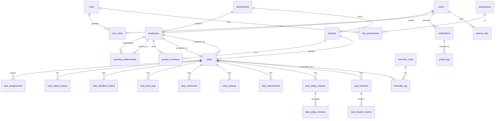

# Document 5 — Database Design (MySQL 8, InnoDB, utf8mb4)

Conventions: PK `id BIGINT UNSIGNED AUTO_INCREMENT`; timestamps `DATETIME(6)` **UTC**; `created_at` default `UTC_TIMESTAMP(6)`; enums as `VARCHAR` + CHECK (easier migrations than MySQL ENUM) or lookup table where config-driven; soft-delete via `is_active`/`deleted_at` for org entities; history tables are **append-only**. `NN` = NOT NULL. FKs are `ON DELETE RESTRICT` unless noted. Money/Decimal not needed; hours stored as `DECIMAL(7,2)`, durations as integer **seconds**.

## 1. ER diagram

## 2. Tables

### Identity & access
**users** — auth only. `id PK` · `email VARCHAR(255) NN` **UQ** · `password_hash VARCHAR(255) NN` · `is_active BOOL NN def 1` · `must_change_password BOOL` · `token_version INT NN def 0` · `failed_logins INT def 0` · `locked_until DATETIME NULL` · `mfa_secret_enc VARBINARY NULL` · `last_login_at NULL` · `timezone VARCHAR(64) NN def 'UTC'` · `created_at/updated_at`.
**refresh_tokens** — `id PK` · `user_id FK NN` · `family_id CHAR(36) NN` · `token_hash CHAR(64) NN` **UQ** · `expires_at NN` · `revoked_at NULL` · `replaced_by_id NULL` · `ip`, `user_agent` · IDX `(user_id)`, `(family_id)`.
**password_reset_tokens** — `user_id FK`, `token_hash UQ`, `expires_at NN`, `used_at NULL`.
**roles** — `id` · `code VARCHAR(50) NN` **UQ** · `name NN` · `rank SMALLINT NN` · `is_system BOOL` (system roles not deletable) · `description`.
**permissions** — `id` · `code VARCHAR(80) NN` **UQ** · `description` · `category`.
**role_permissions** — PK `(role_id, permission_id)` · both FK · `scope VARCHAR(20) NN CHECK in (self,team,department,organization)`.
**user_roles** — PK `(user_id, role_id)` · `granted_by FK users` · `granted_at` · IDX `(role_id)`.

### Organization
**departments** — `id` · `name NN` **UQ** · `code NN` **UQ** · `parent_id FK NULL` · `head_employee_id FK employees NULL` · `is_active` · timestamps. *(Support/Sales/Accounts: head NULL; future head = set this + a role.)*
**employees** — `id` · `user_id FK NN` **UQ** (1:1 with users, no duplicated identity) · `employee_code NN` **UQ** · `full_name NN` · `phone` · `job_title` (e.g. "AI/ML Developer" — free text/lookup, not hardcoded) · `department_id FK NN` · `status VARCHAR(20) NN` (active/on_leave/inactive) · `joined_on DATE` · `left_on DATE NULL` · `daily_capacity_hours DECIMAL(4,2) NN def 8` · `can_receive_tasks BOOL NN def 1` · IDX `(department_id,status)`.
**reporting_relationships** — effective-dated adjacency list. `id` · `employee_id FK NN` · `reports_to_id FK employees NN` · `relation_type VARCHAR(20) NN def 'primary'` (primary/dotted) · `effective_from DATETIME NN` · `effective_to DATETIME NULL` · `created_by FK` · CHECK `employee_id <> reports_to_id` · IDX `(employee_id, effective_to)`, `(reports_to_id, effective_to)` · **UQ** `(employee_id, relation_type, active_flag)` where `active_flag` = generated `IF(effective_to IS NULL,1,NULL)` ⇒ only one active primary manager. Cycle prevention in service layer (recursive CTE check inside transaction).
**manager_departments** — `(employee_id, department_id)` PK: departments a Manager supervises in addition to reporting subtree (Q1).

### Projects & tasks
**projects** — `id` · `code` **UQ** · `name NN` · `description` · `department_id FK NULL` · `owner_employee_id FK` · `status` (active/on_hold/completed/archived) · `starts_on`, `ends_on` · `requires_review_default BOOL def 1` · IDX `(department_id,status)`.
**project_members** — PK `(project_id, employee_id)` · `member_role`.
**task_categories** / **task_types** — `id`, `name` UQ, `requires_review BOOL`, `default_estimate_hours`, `is_active` (config tables, so categories/types aren't hardcoded).
**tasks** — the *current-state* row only; history lives elsewhere.
`id` · `task_no VARCHAR(20) NN` **UQ** (e.g. TSK-000123) · `title VARCHAR(200) NN` · `description MEDIUMTEXT NN` · `instructions TEXT NULL` · `project_id FK NULL` · `department_id FK NN` · `category_id FK NULL` · `type_id FK NULL` · `assignee_id FK employees NN` · `assigned_by_id FK employees NN` · `priority VARCHAR(10) NN` (critical/high/medium/low) · `priority_rank TINYINT NN` (1–4, for sorting) · `manual_rank INT NULL` (manager override of order) · `status VARCHAR(20) NN` · `status_before_hold VARCHAR(20) NULL` · `assigned_at NN` · `start_date DATE NULL` · `original_due_at NN` (**immutable**, enforced by trigger/service) · `due_at NN` · `deadline_version INT NN def 1` · `extension_count INT NN def 0` · `estimated_seconds INT NN` · `progress_pct TINYINT NN def 0` · `requires_review BOOL NN` · `acknowledged_at NULL` · `first_started_at NULL` · `submitted_at NULL` · `completed_at NULL` · `completed_by_id NULL` · `verified_at NULL` · `verified_by_id FK NULL` · `revert_count INT NN def 0` · `cancelled_at NULL` · `cancel_reason` · `overdue_since DATETIME NULL` · `delay_explanation_required BOOL NN def 0` · `active_seconds_cache INT def 0` · `blocked_seconds_cache INT def 0` · `parent_task_id FK NULL` · `version INT NN def 1` (optimistic lock) · `created_at/updated_at`.
Indexes: `(assignee_id,status,due_at)` · `(department_id,status,due_at)` · `(status,due_at)` *(scanner)* · `(assigned_by_id)` · `(project_id)` · `(overdue_since)` · FULLTEXT `(title,description)` · CHECK `due_at >= assigned_at`, `progress_pct BETWEEN 0 AND 100`, `estimated_seconds > 0`.
*Caches* (`active_seconds_cache`…) are derived and re-computable from logs; reports use the logs, dashboards use caches.
**task_assignments** — assignment history/reassignments. `id`, `task_id FK`, `assignee_id FK`, `assigned_by_id FK`, `role VARCHAR(15) def 'assignee'` (assignee/collaborator – future), `assigned_at NN`, `unassigned_at NULL`, `reason`. IDX `(task_id)`, `(assignee_id, unassigned_at)`.
**task_status_history** — `id`, `task_id FK`, `from_status NULL`, `to_status NN`, `changed_by_id FK users NULL` (NULL = system), `reason`, `created_at`. IDX `(task_id, created_at)`.
**task_deadline_history** — `id`, `task_id FK`, `deadline_version INT NN`, `previous_due_at NN`, `new_due_at NN`, `changed_by_id FK users NN`, `change_type` (initial/extension/shorten/approved_request), `reason TEXT NN`, `request_id FK NULL`, `created_at`. **UQ** `(task_id, deadline_version)`. Original deadline = first row (+ immutable `tasks.original_due_at`).
**deadline_extension_requests** *(S)* — `task_id`, `requested_by`, `requested_due_at`, `reason`, `status`, `decided_by`, `decided_at`, `decision_note`.
**task_time_logs** — one row per work session. `id`, `task_id FK NN`, `employee_id FK NN`, `started_at NN`, `ended_at NULL`, `duration_seconds INT NULL` (set on close), `source VARCHAR(15) NN` (timer/manual/auto_closed/correction), `end_reason` (stopped/paused/blocked/switched/auto_timeout/review_submit), `status VARCHAR(12) def 'approved'` (approved/pending/rejected – manual entries), `note`, `created_by FK users`, `created_at`.
 **`active_employee_key BIGINT GENERATED ALWAYS AS (IF(ended_at IS NULL AND status='approved', employee_id, NULL)) STORED` + UNIQUE** ⇒ DB itself forbids two open sessions per employee (MySQL lacks partial indexes, so a generated column is the idiom). Overlap check for manual/closed ranges done in service inside a transaction holding `FOR UPDATE` on the employee row. IDX `(task_id)`, `(employee_id, started_at)`. CHECK `ended_at IS NULL OR ended_at > started_at`.
**task_time_corrections** — `id`, `time_log_id FK`, `requested_by`, `old_started_at`, `old_ended_at`, `new_started_at`, `new_ended_at`, `reason NN`, `status`, `decided_by`, `decided_at`. Original log row is retained ⇒ full audit.
**task_updates** — progress updates (append-only). `id`, `task_id`, `author_id`, `progress_pct`, `note TEXT NN`, `created_at`. IDX `(task_id, created_at)`.
**task_comments** — `id`, `task_id FK`, `author_id FK users`, `parent_id NULL`, `kind` (comment/question/clarification/reply), `body TEXT NN`, `visibility` (all/managers_only), `edited_at NULL`, `created_at`. Soft-delete not allowed for employees (rule 3); moderation by Owner = `deleted_at` + audit.
**comment_mentions** — `(comment_id, user_id)` PK.
**task_attachments** — `id`, `task_id FK`, `uploaded_by FK users`, `context` (task/comment/delay_reason/blocker), `context_id NULL`, `original_name`, `stored_key CHAR(40) NN` UQ, `mime_type`, `size_bytes`, `sha256 CHAR(64)`, `scan_status`, `created_at`. IDX `(task_id)`.
**task_delay_reasons** — append-only. `id`, `task_id FK NN`, `employee_id FK NN`, `deadline_version INT NN` (which deadline was missed), `reason NN`, `progress_pct NN`, `work_completed NN`, `remaining_work NN`, `blockers_text`, `expected_completion_at NN`, `attachment_id NULL`, `kind` (initial/update), `created_at NN`. IDX `(task_id, created_at)`. No UPDATE/DELETE grant.
**task_delay_reviews** — `id`, `delay_reason_id FK`, `reviewer_id FK users`, `decision` (accepted/clarification_requested/rejected/revised_deadline_approved/escalated), `comment`, `deadline_history_id NULL` (links to new deadline), `created_at`.
**task_blockers** — `id`, `task_id FK`, `raised_by FK employees`, `blocker_type` (technical/dependency/info/resource/access/other), `title`, `description NN`, `impact`, `blocks_work BOOL NN`, `expected_resolution`, `status VARCHAR(15) NN` (open/acknowledged/in_progress/resolved/closed), `owner_id FK users NULL`, `opened_at NN`, `resolved_at NULL`, `closed_at NULL`, `resolution_note`. IDX `(task_id,status)`, `(status, opened_at)`. Blocked time = `resolved_at − opened_at` where `blocks_work`.
**task_blocker_events** — append-only history: `blocker_id`, `actor_id`, `event` (created/acknowledged/replied/reassigned/escalated/resolved/closed/reopened), `from_status`, `to_status`, `note`, `created_at`.

**task_completion_assurances** — append-only, one per completion/resubmission. `id`, `task_id FK`, `employee_id FK`, `summary TEXT NN`, `tested BOOL NN`, `test_notes TEXT NULL`, `evidence_url VARCHAR(500) NULL`, `attachment_id FK NULL`, `completion_no INT NN` (1,2,… after each revert), `created_at`. **UQ** `(task_id, completion_no)`.
**task_reverts** — `id`, `task_id FK`, `completion_no INT NN` (which completion was reverted), `reverted_by_id FK users NN`, `reason_code VARCHAR(25) NN` (qa_defect/incomplete/requirement_change/other), `reason TEXT NN`, `found_by VARCHAR(40) NULL` (e.g. QA), `evidence_attachment_id NULL`, `created_at`. IDX `(task_id)`, `(reason_code, created_at)`.
**task_verifications** — `id`, `task_id FK`, `completion_no`, `verified_by_id FK users`, `note`, `created_at`.

### Notifications & automation
**notification_rules** — `id`, `event_type NN`, `recipient_selector NN` (ASSIGNEE, MANAGER_CHAIN:1, ROLE:ceo …), `channels SET('in_app','email') NN`, `mandatory BOOL`, `condition_json JSON NULL` (e.g. priority ≥ high, assigner_role = owner), `is_enabled`. IDX `(event_type, is_enabled)`.
**notification_preferences** — PK `(user_id, event_type, channel)`, `enabled`.
**outbox_events** — `id`, `event_type`, `aggregate_type`, `aggregate_id`, `payload JSON`, `actor_user_id NULL`, `created_at`, `processed_at NULL`, `attempts`, `last_error`. IDX `(processed_at, id)`.
**notifications** — `id`, `user_id FK NN`, `event_type NN`, `title NN`, `body`, `task_id FK NULL`, `entity_type/entity_id NULL`, `reasons JSON` (why they got it), `dedupe_key VARCHAR(120) NN`, `is_read BOOL`, `read_at NULL`, `created_at`. **UQ** `(user_id, dedupe_key)` ⇒ duplicates physically impossible. IDX `(user_id, is_read, created_at)`.
**email_logs** — `id`, `notification_id FK NULL`, `to_user_id FK NULL`, `to_email NN`, `subject`, `template`, `status` (queued/sending/sent/failed/bounced/skipped), `attempts`, `next_attempt_at`, `provider_message_id`, `error`, `created_at`, `sent_at`. IDX `(status,next_attempt_at)`, `(notification_id)`.
**reminder_rules** — `id`, `code` UQ (before_24h, before_2h, at_due, after_1d, after_3d, after_7d), `offset_minutes INT NN` (neg = before), `send_if_status SET(...)`, `notify_assignee BOOL`, `escalation_level TINYINT def 0`, `event_type`, `is_enabled`, `sort_order`.
**reminder_log** — `id`, `task_id FK`, `rule_id FK`, `deadline_version INT NN`, `assignee_id FK`, `fired_at NN`. **UQ `(task_id, rule_id, deadline_version, assignee_id)`**. Insert-before-send = exactly-once guard even if the job runs twice.
**work_calendar_rules** *(M, moved earlier)* — `id`, `weekday TINYINT NN` (0=Mon…6=Sun), `nth_in_month TINYINT NULL` (NULL = every; 1–5 = that occurrence), `is_working BOOL NN`, `starts_at TIME NN def '09:30'`, `ends_at TIME NN def '18:30'`, `break_starts_at TIME NULL def '13:30'`, `break_ends_at TIME NULL def '14:00'`, `effective_from DATE NN`, `effective_to DATE NULL`. Seed: Mon–Fri working; Sat working **except nth 2 and 4 (two rows, is_working=0)**; Sun off.
**holidays** — `date UQ`, `name`, `is_working_override BOOL def 0`.
**employee_leaves** — `employee_id`, `from_date`, `to_date`, `type`, `status` (used by capacity/workload).
**system_settings** — `key PK`, `value JSON`, `updated_by`, `updated_at`.
**activity_logs** — append-only audit. `id`, `actor_user_id NULL`, `action VARCHAR(60) NN`, `entity_type NN`, `entity_id NN`, `task_id NULL` (denormalized for fast per-task timeline), `before_json JSON`, `after_json JSON`, `ip`, `user_agent`, `request_id`, `created_at`. IDX `(entity_type, entity_id, created_at)`, `(task_id, created_at)`, `(actor_user_id, created_at)`, `(action, created_at)`. Partition by month when > ~10M rows.
**job_failures** — dead-letter view for Admin.

## 3. How the model handles the hard requirements
| Requirement | Mechanism |
|---|---|
| Multiple tasks per employee | `tasks.assignee_id` 1:N; composite index `(assignee_id,status,due_at)` drives the employee list and workload query |
| Reassignment / multiple assigners | `task_assignments` history + `assigned_by_id`; per-task single accountable assignee (Q19) |
| Deadline extensions | Immutable `original_due_at`; `task_deadline_history` append-only; `deadline_version` used by reminders |
| Multiple delay explanations | `task_delay_reasons` 1:N, append-only, tied to `deadline_version`; reviews in separate table |
| Multiple time sessions | `task_time_logs` rows; generated-column unique index forbids parallel open sessions; corrections never overwrite |
| Reporting relationships | Effective-dated adjacency list + recursive CTE; as-of queries for historical reports |
| Department-based permissions | `employees.department_id`, `departments.head_employee_id`, scope `department` in `role_permissions` |
| Notification history | `notifications` + `email_logs` + `reminder_log`, `dedupe_key` UQ |
| Task activity history | `task_status_history`, deadline/updates/comments/blockers events, plus `activity_logs.task_id` as unified timeline |

## 4. Core queries (sanity-checked design)
- **Team scope:** `WITH RECURSIVE sub AS (SELECT employee_id FROM reporting_relationships WHERE reports_to_id=:me AND effective_to IS NULL UNION ALL SELECT r.employee_id FROM reporting_relationships r JOIN sub s ON r.reports_to_id=s.employee_id WHERE r.effective_to IS NULL) …` (cache per request/minute; depth ≤ 6 in practice).
- **Overdue:** `status NOT IN ('completed','cancelled') AND due_at < UTC_TIMESTAMP(6)` → uses `(status,due_at)`.
- **Workload:** Σ `GREATEST(estimated_seconds − active_seconds_cache,0)` of open tasks due ≤ now+7d ÷ capacity.
- **Scanner:** for each enabled rule, `tasks WHERE status IN (:send_if) AND due_at + offset <= now AND NOT EXISTS (reminder_log …)` — bounded by a lookback window (e.g. 48 h for pre-due, unbounded for post-due levels).

## 5. Integrity safeguards
- Triggers (or service + tests) forbid UPDATE of `tasks.original_due_at`; app DB user lacks UPDATE/DELETE on history/audit/delay/deadline tables.
- All status/priority/etc. columns have CHECK constraints (MySQL 8.0.16+ enforces).
- Every FK indexed; composite indexes ordered by selectivity; `EXPLAIN` reviewed for dashboard queries in Phase 8.
- Migrations: Alembic, one revision per change, reviewed by human; seed data (roles, permissions, reminder rules, notification rules, departments, settings) in a separate idempotent seeder, never in migrations.
