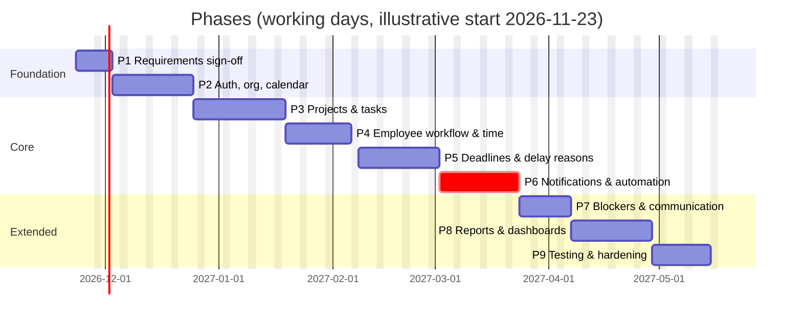

# Document 11 — Project Plan: Features, Phases, Tasks

Scope: everything **except hosting/deployment** (deferred). Estimates are *realistic working days* (Claude implements, 1 senior human reviews and decides, includes rework and review time; frontend/backend slices run in parallel via sub-agents but the human review path is sequential, so per-task days add up to the phase total). Weeks = 5 working days. Task IDs are `P<phase>.<n>`; layer tags: **DB** database · **BE** backend · **FE** frontend · **QA** tests · **OPS** repo/dev tooling · **DOC**. Requirement IDs refer to [02-SRS.md](02-SRS.md).

## 1. Working rules baked into the plan (from your answers)
- One Manager; Owner → CEO → Manager → Dept Heads (Developers, HR, Marketing) → employees; Support/Sales/Accounts report directly to the Manager. No upward assignment. Employees never create tasks.
- Company hours **09:30–13:30 and 14:00–18:30** (break 13:30–14:00, **8.5 productive h/day**); **EOD = 18:30**; Mon–Sat working except **2nd & 4th Saturday**; **every Sunday off**; holidays table. *(Confirmed.)*
- Employee **marks Complete** with an assurance; review is optional (`requires_review` default off); Manager/Head/CEO/Owner may **Verify** or **Revert** (e.g. QA finds the feature broken).
- Forgotten timers: check-ins at 4 h / 8 h / 19:00, auto-close at 10 h or 22:00, provisional until confirmed (SRS §6).
- No hosting work; dev environment + CI only.

## 2. Feature catalogue
| ID | Feature | Key capabilities | Phase | MVP |
|---|---|---|---|---|
| F1 | Authentication & security | Login, refresh rotation, lockout, reset, rate limits, optional MFA | 2 (MFA 9) | ✔ (MFA ✖) |
| F2 | Roles, permissions, scope engine | Dynamic RBAC × scope, rank rules, `/auth/me` permission map | 2 | ✔ |
| F3 | Organization | Departments, employees, effective-dated reporting lines, hierarchy tree, offboarding queue | 2 | ✔ |
| F4 | Work calendar | Hours, nth-Saturday-off rules, holidays, leaves, EOD resolver, capacity | 2 | ✔ |
| F5 | Audit & settings | Append-only activity log, system settings, audit viewer | 2 (viewer 8) | ✔ |
| F6 | Projects & configuration | Projects, members, categories, task types | 3 | ✔ (members ✖) |
| F7 | Task management | Create/assign, list/filter/sort/search, detail, edit, reassign, priority, cancel, attachments, state machine | 3 | ✔ |
| F8 | Employee workflow | My Day, acknowledge, progress, **complete with assurance**, optional review | 4 | ✔ |
| F9 | Verification & revert | Verify, revert with reason codes (QA), rework metrics | 4 | ✔ |
| F10 | Time tracking | Start/pause/resume/stop, switch, sessions, corrections, forgotten-timer flow, active vs elapsed vs blocked | 4 | ✔ |
| F11 | Deadline management | Immutable original, versioned history, extension count, EOD input, extension requests | 5 | ✔ (requests ✖) |
| F12 | Overdue & delay accountability | Derived overdue, mandatory explanation gate, append-only reasons, manager decisions | 5 | ✔ |
| F13 | Notifications | Outbox, rule-based recipients, dedupe, in-app + WebSocket, email + logs + retry, preferences | 6 | ✔ |
| F14 | Reminders & escalation | Rules, scanner, `reminder_log`, working-day escalations | 6 | ✔ |
| F15 | Blockers & communication | Comments/questions/mentions, blocker lifecycle, blocked-time accounting | 7 | ✔ (basic) |
| F16 | Dashboards | Owner, CEO, Manager, Dept Head, Employee | 4 (employee) · 8 (others) | ✔ |
| F17 | Reports & exports | 12 reports, filters, CSV/XLSX (PDF later) | 8 | ✔ (5 key) |
| F18 | Quality & hardening | Regression, security, performance, accessibility, UAT | 9 | ✔ |
| F19 | Deferred | Hosting, backups, monitoring, SSO, MFA enforcement, digests, watchers, sub-tasks, templates | — | ✖ |

## 3. Timeline (illustrative start after approval)

Cumulative: P1 wk 2 · P2 wk 5 · P3 wk 8.5 · P4 wk 11.5 · P5 wk 14.5 · **P6 wk 17.5 (internal pilot with Developers dept)** · P7 wk 19.5 · P8 wk 22.5 · P9 wk 25. **Total ≈ 125 working days ≈ 25 weeks.** Calendar will extend with festivals/leave and review latency — add ~10% contingency when quoting dates.

## 4. Phase task breakdown

### Phase 1 — Requirements sign-off (8 d)
**Goal:** freeze rules so no phase starts on guesses. **Depends on:** nothing.
| Task | Layer | Description | Days |
|---|---|---|---|
| P1.1 | DOC | Confirm the one remaining item: company timezone (all other calendar/completion questions are settled) | 1 |
| P1.2 | DOC | Clickable wireframes (6 screens: management dashboard, create task, task detail, My Day, delay form, blocker form) | 3 |
| P1.3 | DOC | Seed org + demo data spec (Owner, CEO, Manager, 3 heads, ABC AI/ML dev, support/sales/accounts staff) | 1 |
| P1.4 | DOC | ADRs: Python 3.12/3.13, sync SQLAlchemy, JWT strategy, outbox pattern | 1 |
| P1.5 | DOC | Test plan + FR→test traceability skeleton | 1 |
| P1.6 | DOC | Final review of docs 00–11, formal approval | 1 |
**Done when:** signed approval; open-question list empty or defaulted in writing.

### Phase 2 — Auth, organization & work calendar (16 d)
**Goal:** secure foundation every later feature depends on. **Depends on:** P1. **Reqs:** FR-001–016, FR-089, FR-120–121.
| Task | Layer | Description | Days |
|---|---|---|---|
| P2.1 | OPS | Monorepo scaffold (`backend/`, `frontend/`), `CLAUDE.md`, Claude settings + hooks, ruff/mypy/pytest, eslint/tsc/vitest, pre-commit, CI pipeline | 1.5 |
| P2.2 | OPS | Local dev stack: Docker Compose (Redis 7, Mailhog), `.env` handling, `make` targets, `make demo-data` stub | 0.5 |
| P2.3 | BE | Core: settings, DB session, error envelope, injectable `Clock`, structured logging, request-id | 0.5 |
| P2.4 | DB | Alembic baseline; users, refresh/reset tokens, roles, permissions, role_permissions, user_roles; idempotent seeder | 1 |
| P2.5 | BE | Auth: login, argon2id, lockout, JWT, refresh rotation + reuse detection, logout/all, forgot/reset/change password, rate limiting | 2 |
| P2.6 | BE | Policy engine: permission × scope, rank rule, recursive-CTE team scope, FastAPI dependencies, 404-for-out-of-scope | 2 |
| P2.7 | DB+BE | Departments, employees, effective-dated reporting relationships (cycle + single-manager guards), manager change, dept-head change, offboarding orphan list | 1.5 |
| P2.8 | DB+BE | Work calendar: rules (2nd/4th Sat off), holidays, leaves, EOD resolver, working-day arithmetic, capacity; DST/edge tests | 1 |
| P2.9 | BE | Audit-log writer (append-only grants), system settings store | 0.5 |
| P2.10 | FE | Vite/React/Tailwind/shadcn scaffold, router, TanStack Query, generated API client, app shell, login/forgot, role-aware nav, `<Can>` | 1.5 |
| P2.11 | FE | Screens: employees, departments, hierarchy tree, roles & permissions (calendar page dropped by decision; the calendar API and rules stay for EOD/capacity logic) | 2 |
| P2.12 | QA | Permission-matrix YAML + generated parametrized tests (org features) | 0.5 |
| P2.13 | QA | Phase test pass, `/code-review` + `/security-review`, human review of migrations & policy | 1.5 |
**Done when:** manager sees only their subtree, head only their department; hierarchy change preserves history; refresh-token reuse revokes the family; no department/role names hardcoded; calendar returns correct working days for a month with 2nd/4th Saturdays.

### Phase 3 — Projects & tasks (17 d)
**Goal:** create and assign tasks safely. **Depends on:** P2. **Reqs:** FR-020, FR-030–038, FR-043, FR-045.
| Task | Layer | Description | Days |
|---|---|---|---|
| P3.1 | DB+BE | Projects (+ members) | 1 |
| P3.2 | DB+BE | Task categories & types (config tables; `requires_review` per type) | 0.5 |
| P3.3 | DB | Tasks, task_assignments, task_status_history, attachments tables + indexes + CHECKs | 0.5 |
| P3.4 | BE | Table-driven state machine (SRS §3), status history, optimistic version, 409 `INVALID_TRANSITION` | 2 |
| P3.5 | BE | Create/assign: scope + rank validation, EOD/exact deadline → UTC, non-working-day warning, estimate rules, task numbering | 2 |
| P3.6 | BE | Task list: filters, sort (priority engine), pagination, FULLTEXT search | 1 |
| P3.7 | BE | Task detail with `allowed_actions`, unified timeline | 1 |
| P3.8 | BE | Edit, reassign, priority change, cancel (reason), field-level permissions | 1 |
| P3.9 | BE | Attachments: allow-list, magic-byte check, size cap, storage interface, authorized download | 1 |
| P3.10 | FE | Create-task form with workload/conflict side panel (EOD toggle) | 2 |
| P3.11 | FE | Task list (table + board), filters, saved views | 1 |
| P3.12 | FE | Task detail shell, project screens | 1.5 |
| P3.13 | QA | IDOR/authz matrix for tasks, state-machine table tests, upload abuse tests, 50k-task performance seed | 1 |
| P3.14 | QA | Phase review + buffer | 1.5 |
**Done when:** the Owner→ABC "Develop AI Chatbot API" example works end to end; manager cannot assign upward or outside scope; invalid transitions rejected; employee sees only own tasks.

### Phase 4 — Employee workflow, completion & time tracking (14 d)
**Goal:** employees do the work; managers can verify/revert. **Depends on:** P3. **Reqs:** FR-038–042c, FR-080–089.
| Task | Layer | Description | Days |
|---|---|---|---|
| P4.1 | DB | Time logs (generated-column unique key), corrections, task_updates, completion assurances, reverts, verifications | 0.5 |
| P4.2 | BE | Timer service: start/pause/resume/stop/switch with row locking; server-time only | 2 |
| P4.3 | QA | Property + concurrency tests (parallel starts, no overlaps, no negative durations) | 0.5 |
| P4.4 | BE | Acknowledge; progress updates (append-only) | 0.5 |
| P4.5 | BE | Mark Complete with assurance + guards; review-required path (submit/approve) | 1.5 |
| P4.6 | BE | Verify; Revert with reason codes + `revert_count`; reopen re-arms workflow | 1 |
| P4.7 | BE | Manual-time requests & corrections approval (originals kept) | 1 |
| P4.8 | BE | Forgotten-timer logic: check-in events, hard cap, provisional/confirm/shorten flow, 3-day manager alert (notification delivery wired in P6) | 1.5 |
| P4.9 | FE | **My Day** dashboard (priority engine order, workload pill) | 1 |
| P4.10 | FE | Timer widget (server-hydrated, offline-aware), time screens, confirm-auto-closed prompt | 1.5 |
| P4.11 | FE | Complete dialog (assurance checklist), verify/revert dialogs | 1 |
| P4.12 | QA | Playwright "employee day" E2E, phase review, buffer | 1.5 |
**Done when:** refresh/close-browser keeps the timer; a second device cannot start a parallel timer; the 3-session example totals 9 h; employee completes with assurance; Manager reverts with "QA defect" and the history shows both.

### Phase 5 — Deadlines, overdue & delay accountability (16 d)
**Goal:** enforce deadline discipline. **Depends on:** P4. **Reqs:** FR-050–054, FR-062–063, FR-070–075.
| Task | Layer | Description | Days |
|---|---|---|---|
| P5.1 | BE | Deadline service: immutable original, version bump, history, reason ≥ 10 chars, extension counting | 2 |
| P5.2 | BE | Domain events for deadline/overdue/delay (consumed in P6) | 0.5 |
| P5.3 | DB+BE | Extension requests (employee asks, manager decides) *(post-MVP, cut first if late)* | 1 |
| P5.4 | BE | Overdue derivation + `overdue_since` + "delay explanation required" logic (pure, clock-injected) | 1.5 |
| P5.5 | DB+BE | Delay reasons append-only; DB-level no UPDATE/DELETE grants; links to deadline version | 1.5 |
| P5.6 | BE | Manager decisions: accept / clarify / reject / approve revised deadline / escalate | 1.5 |
| P5.7 | BE | Working-day arithmetic for +1d/+3d/+7d escalation tiers; re-require rule (Q13) | 1 |
| P5.8 | BE | Extension & delay statistics queries | 0.5 |
| P5.9 | FE | Deadline card + change dialog (original / current / ×N / history) | 1 |
| P5.10 | FE | Overdue queue; non-dismissible delay-reason gate and form | 2 |
| P5.11 | FE | Delay review screens (history, decisions) | 1.5 |
| P5.12 | QA | Frozen-clock timeline fixtures, DB-privilege tests, authorization tests | 1 |
| P5.13 | QA | Phase review + buffer | 1.5 |
**Done when:** a task with two extensions shows original + current + count + who/why; original never changes (DB-level test); explanations can't be edited/deleted; accepting an explanation does not complete the task; employee can't dismiss the gate.

### Phase 6 — Notifications & automation (16 d) — **MVP pilot milestone**
**Goal:** the system tells the right people at the right time, exactly once. **Depends on:** P3, P5. **Reqs:** FR-060–064, FR-100–105.
| Task | Layer | Description | Days |
|---|---|---|---|
| P6.1 | OPS+BE | Celery app, queues (`default`, `emails`, `reports`), beat singleton + `GET_LOCK` guard | 1 |
| P6.2 | DB+BE | Outbox table + relay job (`SKIP LOCKED`) | 1.5 |
| P6.3 | DB+BE | Notification rules schema + seed; **recipient resolver** (assignee, assigner, manager chain, dept head, role, watchers) | 2 |
| P6.4 | BE | Dedupe (`user, dedupe_key` unique), merged reasons, preferences, mandatory events | 1 |
| P6.5 | BE | Notification APIs, WebSocket gateway with ticket auth, Redis pub/sub | 1.5 |
| P6.6 | BE | Email: Jinja templates, SMTP sender, `email_logs`, retries 1m→12h, bounce handling | 1.5 |
| P6.7 | DB+BE | Reminder rules + 1-minute scanner + `reminder_log` unique key + escalation levels (24 h, 2 h, due, +1/+3/+7 working days) | 2 |
| P6.8 | BE | Wire timer check-in prompts, forgotten-timer and assignment/deadline/overdue/blocker events to rules | 0.5 |
| P6.9 | BE | Email send window (working hours) with urgent bypass | 0.5 |
| P6.10 | FE | Admin: notification/reminder rules, email log + retry, failed jobs | 1 |
| P6.11 | FE | Bell, notification center, preferences, WS client with polling fallback | 1.5 |
| P6.12 | QA | Reminder matrix (frozen clock), scanner double/parallel-run, SMTP-failure, stale-reminder-after-extension, WS load test | 1.5 |
| P6.13 | QA | Phase review + buffer | 0.5 |
**Done when:** Owner assigns ABC → ABC, Manager, Developers Head and CEO each get exactly one notification (in-app + email); running the scanner twice sends nothing new; extending the deadline cancels the old schedule; completed/cancelled tasks stop reminders; SMTP outage never blocks in-app delivery.
**Milestone M5 — internal pilot** with the Developers department (2 weeks, real tasks) before building further.

### Phase 7 — Blockers & communication (10 d)
**Depends on:** P3, P4, P6. **Reqs:** FR-090–095.
| Task | Layer | Description | Days |
|---|---|---|---|
| P7.1 | DB+BE | Comments/questions, mentions, contextual attachments, sanitised rendering | 1.5 |
| P7.2 | DB+BE | Blockers: model, lifecycle (Open→Acknowledged→In Progress→Resolved→Closed), event history | 2 |
| P7.3 | BE | Blocker × status × timer interplay (auto Blocked, timer pause, restore previous status), blocked-time accounting | 1.5 |
| P7.4 | BE | Manager actions: reply, assign, resolve, escalate, extend deadline (links to P5) | 1 |
| P7.5 | BE | Notification rules for comments/blockers | 0.5 |
| P7.6 | FE | Discussion tab with mentions | 1.5 |
| P7.7 | FE | Blocker form and queue | 1.5 |
| P7.8 | QA | XSS tests, state interplay tests | 0.5 |
**Done when:** a blocker pauses the timer and excludes waiting time from active time; resolving restores the previous status; full history visible.

### Phase 8 — Dashboards, reports & exports (16 d)
**Depends on:** P4, P5, P7. **Reqs:** FR-110–113, FR-122.
| Task | Layer | Description | Days |
|---|---|---|---|
| P8.1 | BE+QA | Reporting query layer with scope filters; reconciliation tests vs raw logs | 2 |
| P8.2 | BE | Dashboard endpoints for Owner, CEO, Manager, Dept Head | 2.5 |
| P8.3 | BE | Calendar-aware workload (Normal/High/Overloaded), conflicting-deadline detection | 1 |
| P8.4 | BE | 12 reports (completion, on-time, active hours, elapsed — never merged into a score; revert/rework counts) | 3 |
| P8.5 | BE | CSV/XLSX async export jobs with formula-injection protection | 1.5 |
| P8.6 | BE | PDF export *(post-MVP)* | 1 |
| P8.7 | FE | Five dashboards (Recharts), filter bar | 3 |
| P8.8 | FE | Reports UI, filters, export, audit-log viewer | 1.5 |
| P8.9 | BE | EXPLAIN review, index tuning, perf target < 1.5 s | 0.5 |
**Done when:** every number reconciles with raw data; scope respected in every report; completion, on-time, active hours and elapsed time are shown separately; exports open cleanly in Excel.

### Phase 9 — Testing & hardening (12 d, hosting excluded)
| Task | Layer | Description | Days |
|---|---|---|---|
| P9.1 | QA | Full regression + E2E suites for all five roles | 2.5 |
| P9.2 | QA | Security: ASVS checklist, authorization fuzzing, upload/XSS tests, dependency audit, optional MFA for Owner/CEO | 3 |
| P9.3 | QA | Performance test on large seeded data | 1.5 |
| P9.4 | QA | Accessibility audit of core flows | 1 |
| P9.5 | BE/FE | Defect-fix buffer | 2 |
| P9.6 | DOC | User guides per role, training material | 1 |
| P9.7 | QA | UAT with real data, sign-off | 1 |
**Done when:** no open high/critical defects; permission matrix 100% covered by tests; UAT signed. Output: a release-candidate build, ready for a future hosting phase.

## 5. Standing task template (applies to every task, Claude-driven)
1. Plan from the requirement IDs → 2. write rule tests first (state machine, permissions, calendar, reminders, timers) → 3. implement the vertical slice (DB → service+policy → API → UI) → 4. run tests/lint/types and exercise the feature in the running app → 5. `/code-review` and, for auth/permissions/upload code, `/security-review` → 6. human reviews migrations, permissions and rules → 7. update docs/ADR and traceability.

## 6. Schedule risks & levers
| Risk | Lever |
|---|---|
| Rules change mid-build | Freeze at P1; changes via written change request with day impact |
| Review latency of the single human reviewer | Batch reviews per slice; pre-agree acceptance checklists |
| Reminder/timer subtleties take longer | Buffers inside P4–P6; frozen-clock test harness built in P2 |
| Reports expand | Cut to 5 key reports + CSV for MVP; PDF after |
| Need to compress | Drop first: P5.3 extension requests, P8.6 PDF, notification preferences UI; keep integrity features |
